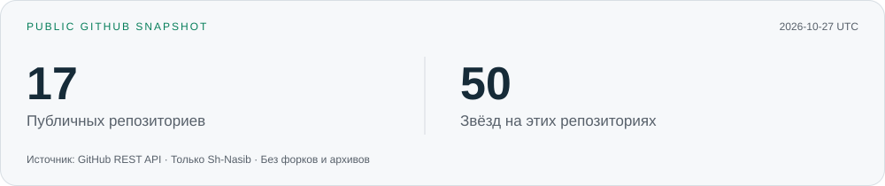

  

  <a href="https://t.me/sh1nasib">Telegram</a>
  &nbsp;·&nbsp;
  <a href="mailto:sh.mamedovich@yandex.ru">Email</a>
  &nbsp;·&nbsp;
  <a href="https://github.com/Sh-Nasib?tab=repositories">GitHub</a>

### Привет, я Шахин

Разработка веб-приложений и аналитика данных. Мой основной стек — **Python, TypeScript и SQL**: от интерфейсов и API до структуры данных, исследований и визуализации.

### Технологии и навыки

| Направление | Инструменты и подходы |
| :--- | :--- |
| **Frontend** | TypeScript · JavaScript · React · Next.js · Tailwind CSS · HTML · CSS |
| **Backend** | Python · FastAPI · Node.js · REST API |
| **Данные** | PostgreSQL · SQL · моделирование и нормализация данных · оптимизация запросов |
| **Аналитика** | pandas · NumPy · Jupyter · визуализация данных · A/B-тесты · Tableau |
| **Интеграции** | 1С · обмен данными · обработка Excel · автоматизация |
| **Инфраструктура** | Linux · Nginx · PM2 · Git · развёртывание и диагностика |

### GitHub в цифрах

Карточка обновляется ежедневно из GitHub API. В ней учтены только мои **публичные репозитории**, без форков и архивов; звёзды суммируются по этим репозиториям.

[**Вся активность и календарь contributions →**](https://github.com/Sh-Nasib?tab=overview)

Работа в закрытых репозиториях не входит в цифры карточки. В календаре GitHub она отображается анонимно, если включён показ private contributions.
